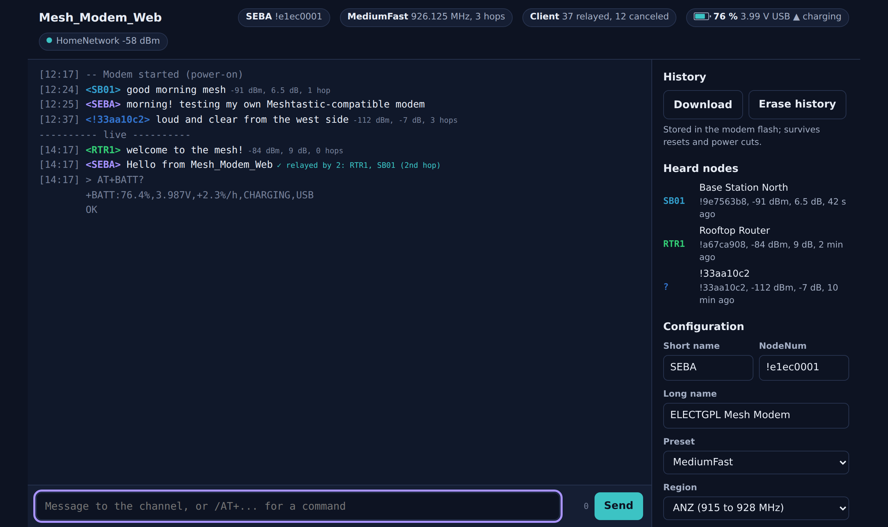
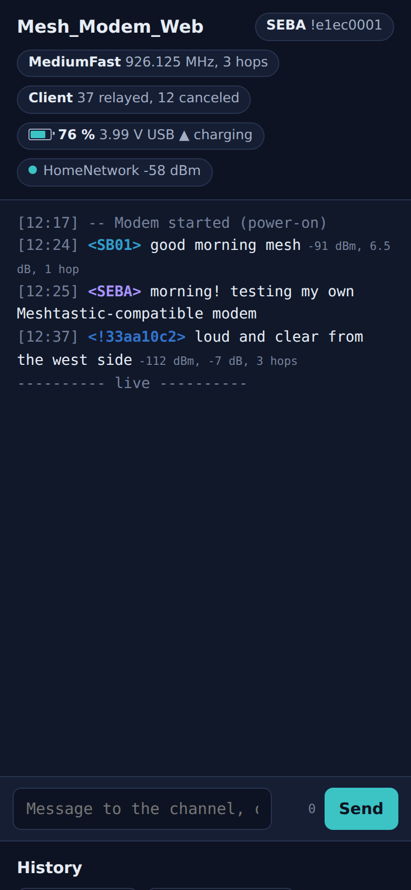
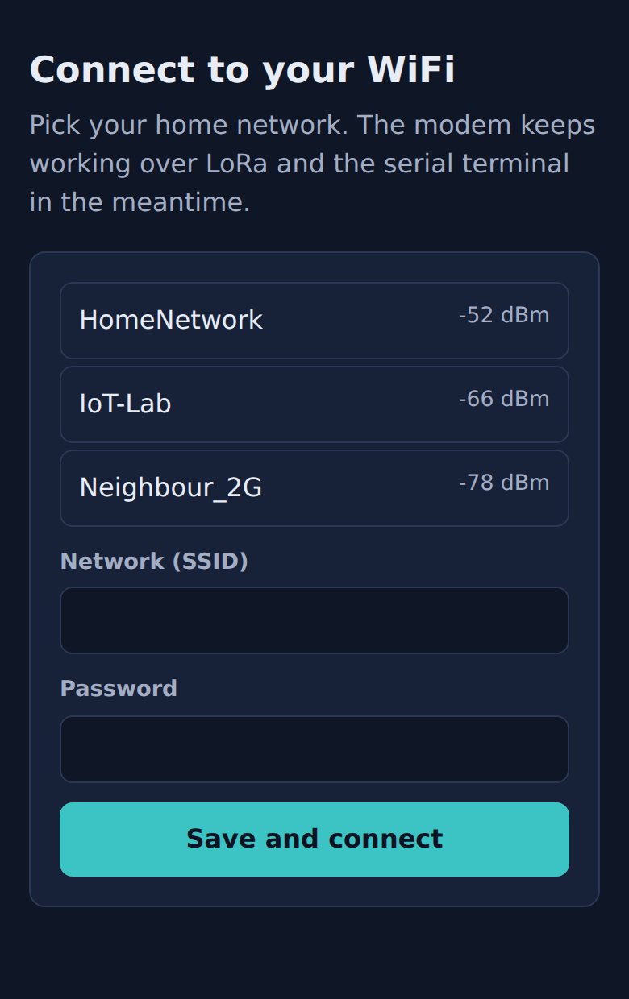
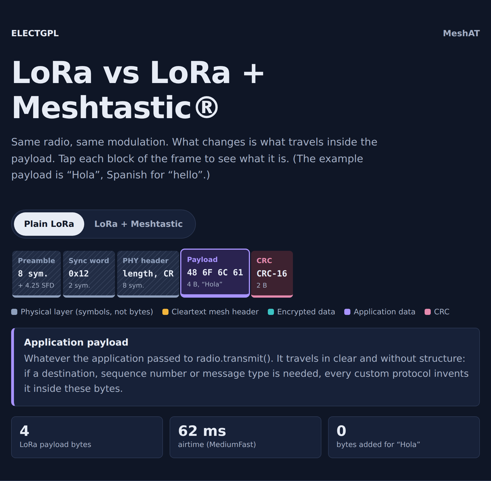
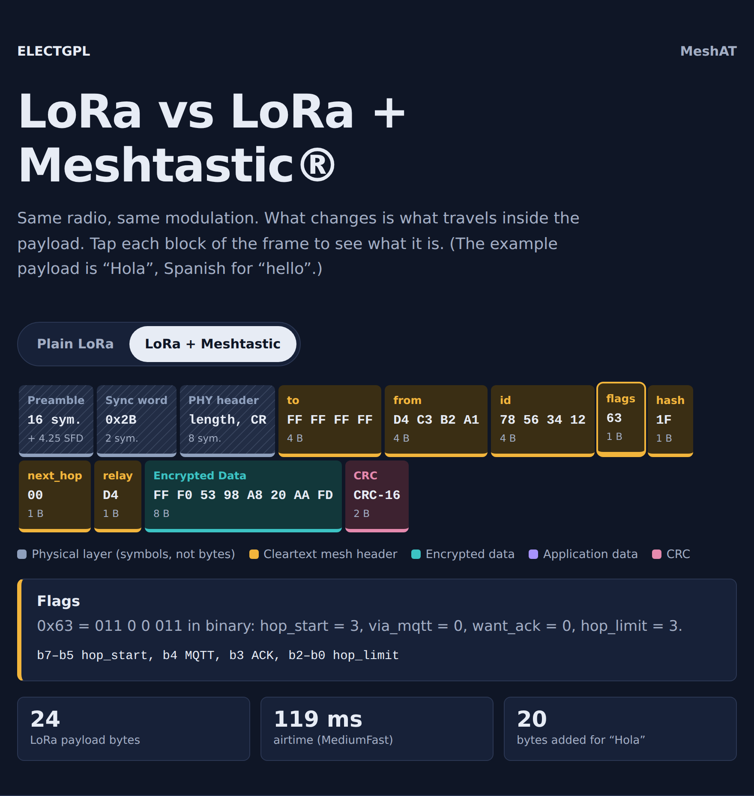
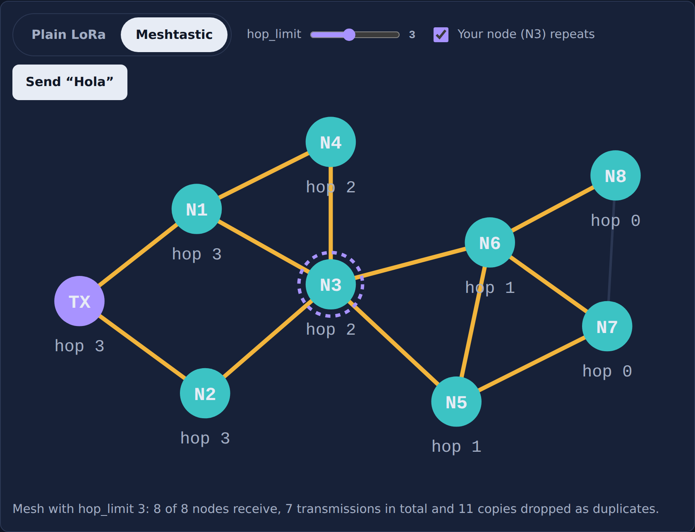
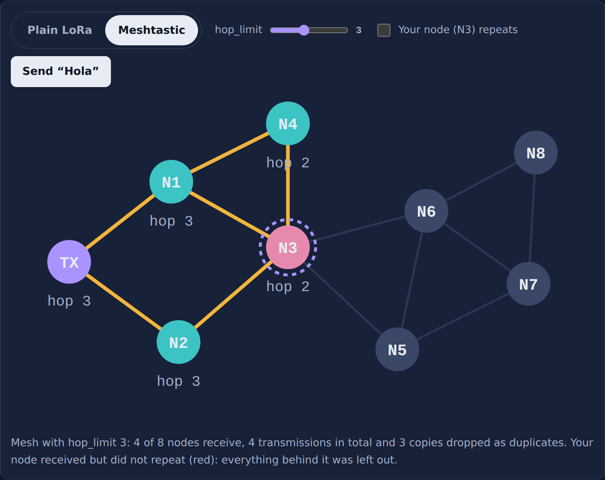
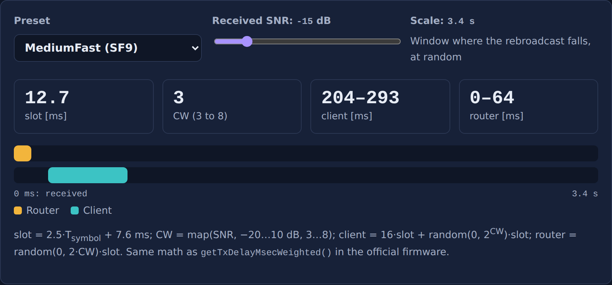

# MeshAT & Mesh_Modem_Web

**LoRa modems compatible with the Meshtastic® network, written from scratch for ESP32-S3 + SX1262.**

No Meshtastic firmware, no nanopb, no mbedtls: the over-the-air frame, the AES-128-CTR encryption, the protobuf encoding and the managed-flooding rules are implemented by hand in a single Arduino sketch. The only external library is [RadioLib](https://github.com/jgromes/RadioLib).



| Firmware | What it is | Size |
|---|---|---|
| [`firmware/MeshAT`](firmware/MeshAT) | Minimal modem controlled only by AT commands over the serial port. Text broadcast + NodeInfo. Does not rebroadcast. A good starting point to understand the protocol. | ~370 lines, 31 % flash |
| [`firmware/Mesh_Modem_Web`](firmware/Mesh_Modem_Web) | Full node: AT commands **plus** IRC-style web chat over WiFi, captive portal, message history in flash, rebroadcasting (hops) with the official contention rules, echo detection (implicit ACK), MAX17048 battery gauge and status LEDs. | 89 % flash |

Both talk to standard Meshtastic nodes on the default primary channel: messages sent from the modem show up in the Meshtastic app and vice versa.

---

## Features (Mesh_Modem_Web)

- **Meshtastic 2.x interoperability**: all 9 modem presets, automatic frequency slot computed from the region band edges (no region table needed), channel hash, NodeInfo with role and `is_unmessagable`.
- **Rebroadcasting**: mute / client / router modes, SNR-weighted contention window identical to `getTxDelayMsecWeighted()`, cancellation when another node repeats first, respects `next_hop`.
- **Echoes**: shows which nodes repeated each of your messages ("✓ relayed by 2: RTR1, SB01").
- **Web chat**: served by the ESP32 itself at `http://meshmodem.local`, mirrored 1:1 with the serial terminal. Lines starting with `/` are sent as AT commands.
- **History**: received and sent messages stored in LittleFS with NTP timestamps; survives resets and power cuts. Every boot is logged with its reset reason (power-on, brownout, watchdog…).
- **Battery and LEDs**: SOC, cell voltage and charge rate from a MAX17048; red LED for power source, green LED for unread messages.
- **No external services**: no cloud, no app, no MQTT required.

| Mobile | Captive portal |
|---|---|
|  |  |

---

## Hardware

Developed on a custom ESP32-S3 + SX1262 board (the ELECTGPL *AlarmSensor* board). Any ESP32-S3 + SX1262 works after adjusting the pin definitions at the top of the sketch.

| Signal | GPIO | Notes |
|---|---|---|
| SX1262 SCK / MISO / MOSI / NSS | 12 / 13 / 11 / 10 | FSPI bus |
| SX1262 RESET / BUSY / DIO1 | 18 / 4 / 14 | DIO1 is polled, no ISR |
| RF switch | 5 | HIGH during TX, driven by RadioLib |
| MAX17048 SDA / SCL | 8 / 9 | optional, address 0x36 |
| Red / green LED | 47 / 48 | optional, HIGH = on |
| BOOT button | 0 | hold 5 s to open the WiFi portal |

The SX1262 module uses a crystal (`TCXO_V 0.0f`). For TCXO modules such as the Wio-SX1262 set `TCXO_V 1.8f` and `DIO2_RFSW true`.

## Quick start

1. Arduino IDE with the **esp32 core 3.x**, board *ESP32S3 Dev Module*, partition *Default 4MB with spiffs*.
2. Install **RadioLib** (7.x) from the Library Manager.
3. Open the sketch and edit the `CONFIG` block. At least set a **unique `NODE_ID`** per board.
4. Flash, open a serial terminal at 115200 8N1 and type `AT+HELP`.
5. Mesh_Modem_Web only: connect to the open WiFi `MeshModem-XXXX`, pick your network in the portal, then browse to `http://meshmodem.local`.

```
AT+NAME=My Node,MYND
AT+PRESET=LongFast
AT+BAND=902,928
AT+SEND=Hello mesh
```

Full command reference: [`firmware/MeshAT/README.md`](firmware/MeshAT/README.md) and [`firmware/Mesh_Modem_Web/README.md`](firmware/Mesh_Modem_Web/README.md).

---

## How it works

Plain LoRa and Meshtastic share exactly the same physical layer. Meshtastic only fixes the sync word (`0x2B`) and the preamble (16 symbols), and gives the payload a structure: a 16-byte cleartext header plus an encrypted protobuf.




Hops are made by the **receivers**: each node repeats a packet once, with `hop_limit − 1`, after a random wait that depends on the SNR. A node that does not rebroadcast (N3 below, red) cuts off everything behind it.

| Your node repeats | Your node does not repeat |
|---|---|
|  |  |



The interactive explainer with all of this (frame inspector, mesh simulation, contention window and channel/airtime calculator) is in [`docs/lora-vs-meshtastic.html`](docs/lora-vs-meshtastic.html). The byte-level protocol description is in [`docs/PROTOCOL.md`](docs/PROTOCOL.md).

---

## Limitations

- **No direct messages.** Since firmware 2.5, Meshtastic only accepts DMs encrypted with public-key cryptography (X25519 + AES-CCM) and rejects channel-encrypted ("legacy") DMs in both directions. The modem announces `is_unmessagable` so apps do not offer DMs to it.
- Only the default primary channel with the public PSK. That channel is readable by anyone.
- No `want_ack` / retries, no position, telemetry, traceroute or MQTT gateway.
- No duty-cycle enforcement: in EU_868 (10 %) that is the user's responsibility.
- Rebroadcasting does not implement next-hop learning, packet upgrading or the `LOCAL_ONLY`/`KNOWN_ONLY` modes.

## Repository layout

```
firmware/MeshAT/            minimal AT modem
firmware/Mesh_Modem_Web/    full node with web chat
tools/stress_tx.py          statistical TX/reset test (pyserial)
docs/PROTOCOL.md            frame, encryption, channel and rebroadcast details
docs/lora-vs-meshtastic.html interactive explainer
docs/images/                screenshots
```

## License

MIT, see [LICENSE](LICENSE). Made by **Sebastián Caccavallo — ELECTGPL** (YouTube channel).

---

*This is an independent project that speaks the same over-the-air frame to interoperate with the Meshtastic network; it is not affiliated with or endorsed by the Meshtastic project.*
*Meshtastic® is a registered trademark of Meshtastic LLC. Meshtastic software components are released under various licenses, see GitHub for details. No warranty is provided - use at your own risk.*
